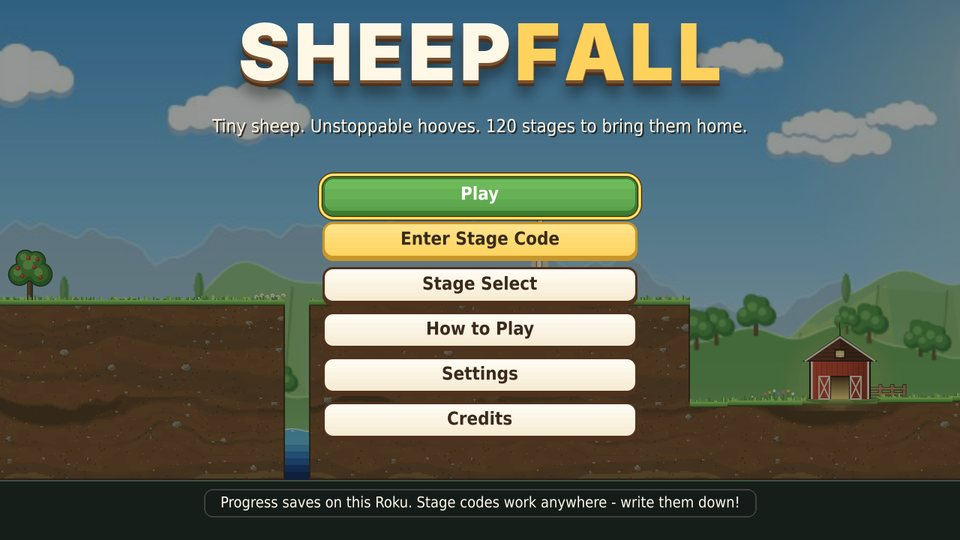
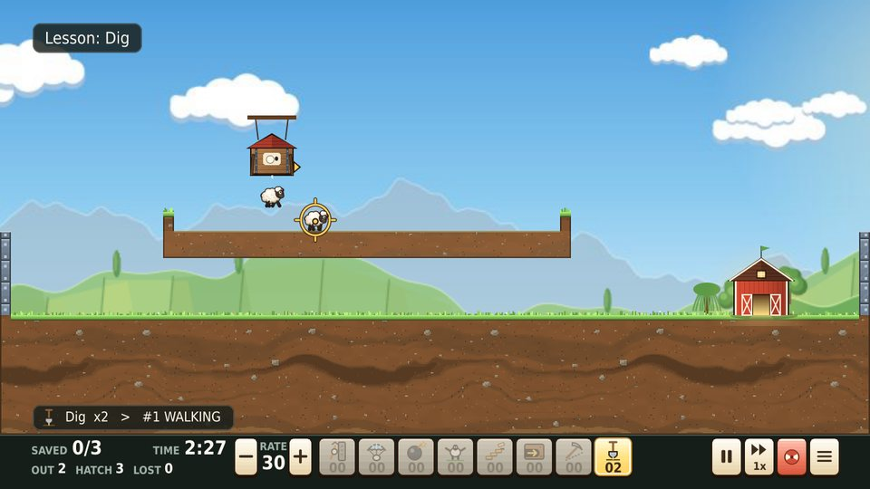
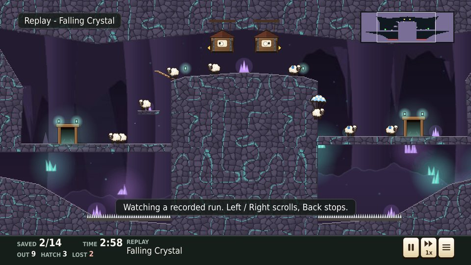
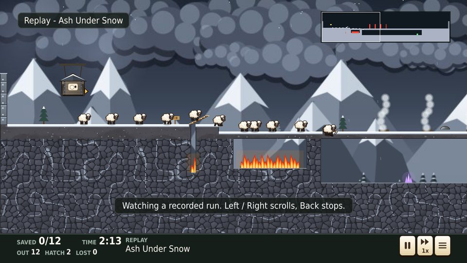
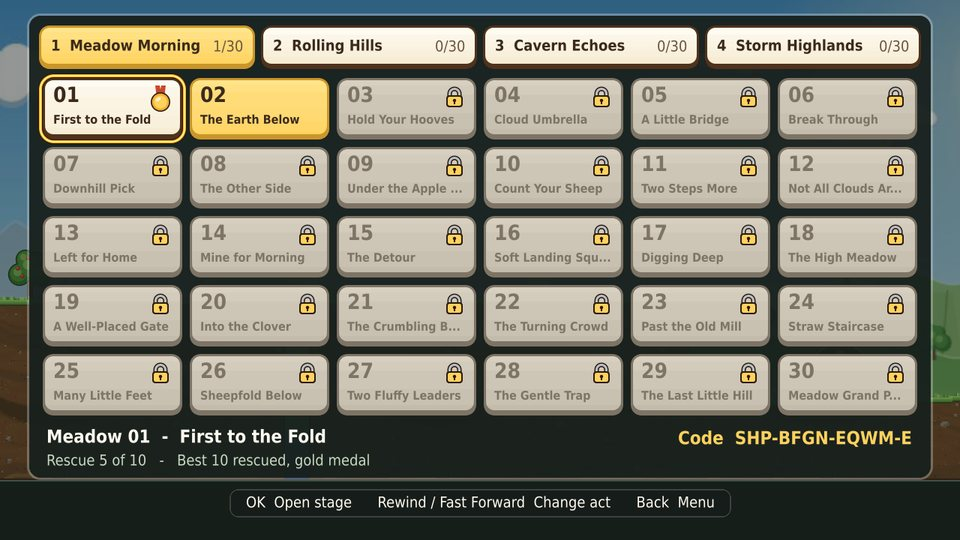
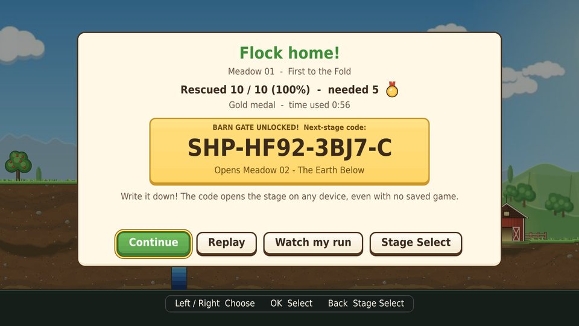

# SHEEPFALL for Roku

A Roku port of [SHEEPFALL](https://github.com/JaredVogler2/Sheep), the crowd-guidance puzzle game: tiny sheep that never stop walking, eight skills to hand out, 120 stages across four biomes.

This repository **is** the Roku app. `manifest`, `source/`, `images/`, `audio/` and `levels/` are the channel; everything else builds and checks it.

| | |
|---|---|
|  |  |
|  |  |
|  |  |

*Screenshots are the app's own output, captured from the brs-node simulator by the smoke test.*

## What is in the port

- **All 120 stages and the 9 lesson stages**, with the web game's titles, quotas, time limits, skill stocks, hazards and scenery.
- **The same simulation.** The 17-ticks-per-second engine is rebuilt in BrightScript and checked against the web engine stage by stage (see [Verification](#verification)).
- **The same stage codes.** `SHP-XXXX-XXXX-C` codes are identical to the web game's, so a code written down on one opens the same stage on the other. No account, no network.
- **All eight skills**, release-rate control, nuke (with a confirmation press), pause that still lets you aim, four speeds, finish-early once the quota is met.
- **Every screen:** title with a living backdrop, stage select, stage brief with a map of the real collision geometry, code entry, How to Play with a playable lesson per skill, results with medals, settings, credits, finale.
- **Watch a solution** (the web game's recorded winning runs), **watch your own run** after a win, and optional **Assisted Mode** rewind.
- **Art and sound from the web game's own generators.** Sprites, terrain textures and backdrops are rendered offline by its procedural art code; effects and the nine tunes are rendered offline from its synthesiser patches and note data.

Not ported: the level editor (it needs a pointer and a keyboard), the notebook / copy / share buttons, and stereo panning.

## Install it on a Roku

1. Put the Roku in developer mode: on the remote press **Home ×3, Up ×2, Right, Left, Right, Left, Right**, accept, and note the IP address and the password you set.
2. Build the package (Node 22+):
   ```sh
   cd tools
   npm ci
   npm run package        # writes out/sheepfall-roku.zip and checks it is under 4 MB
   ```
   Without Node, zipping the five channel items from the repository root works too:
   `zip -r sheepfall-roku.zip manifest source images audio levels`
3. Open `http://<roku-ip>` in a browser, sign in as `rokudev`, choose the zip and press **Install**.

## Controls

| Remote | In a stage |
|---|---|
| Arrows | Move the cursor. It speeds up while held, and the view follows it. |
| OK | Give the skill in hand to the ringed sheep. |
| Rewind / Fast Forward | Previous / next skill. |
| Play/Pause | Pause. The cursor still moves and OK still queues a skill. |
| Instant Replay | Speed: 1x, 2x, 4x, ½x. |
| `*` | Jump between the playfield and the toolbar. |
| Down at the bottom edge | Enter the toolbar: release rate, skills, pause, speed, finish, nuke, menu. |
| Back | Pause menu: resume, restart, quit. |

A gold ring with reticle ticks means the sheep under the cursor can take the skill in hand; a grey ring means it cannot, and pressing OK says why.

## How it is optimised for Roku

BrightScript is an interpreter and a small Roku has a modest GPU, so the port is designed around what is expensive there.

- **Collision grid without bounds checks.** The per-pixel material grid is one byte array padded on every side (steel above, air elsewhere), so the engine's hot reads are a single indexed load. Stages are stored as run-length row bands and decoded with native string calls instead of a per-pixel loop.
- **Terrain painted from the bands.** The first paint of a stage is a few thousand textured blits derived from the same row bands, not 300,000+ pixel visits; in the simulator it is 15–50 times faster than painting cell by cell. Digging repaints only the edited rectangle. A test proves both paths give identical pixels.
- **One texture budget.** The stage lives in 256 px chunks at world resolution and is drawn 2× with nearest-neighbour scaling. Only the current biome's art is loaded. The sheep atlas ships right-facing only and is mirrored once at start-up.
- **Draw calls kept flat.** The HUD is painted into a bitmap only when a number changes and blitted once per frame. The far backdrop is opaque and replaces the screen clear. Everything that scrolls is culled to the view. Particles are capped at 64.
- **Menus that sleep.** Text-heavy menus redraw only on a key press; between presses the app waits on the message port.
- **A frame-rate guard.** If a Roku averages under about 37 frames per second in a stage, the game drops a backdrop layer at a time and then thins particles, for that session. Rules and timing are never touched.
- **720p UI, 4 MB package.** `ui_resolutions=hd` lets the device scale. The package is 3.25 MB against Roku's 4 MB channel limit, with palette-quantised art and the packager refusing to build over the limit.

More detail: [docs/ARCHITECTURE.md](docs/ARCHITECTURE.md).

## Verification

Everything below runs on the [brs-node](https://github.com/lvcabral/brs-engine) BrightScript simulator, from `tools/`:

| Command | What it proves |
|---|---|
| `npm run lint` | The BrightScript parses and resolves cleanly (BrighterScript `bsc`). |
| `npm run test:engine` | The Roku engine replays the recorded winning solution of all 129 stages and ends in the same state as the web engine: same result, tick, and 64-bit hash over every counter, sheep and terrain cell. |
| `npm run test:paint` | The fast terrain paint and the incremental repaint are pixel-identical on stages from every biome, before and after digging. |
| `npm run test:smoke` | The real app, driven by a scripted remote: every menu, code entry, a deep link, playing and winning a stage, a lesson with cursor aiming and a nuke, Assisted Mode rewind, the finale, and recorded runs in all four biomes. |
| `npm run package` | Every file the app loads is present and the zip is under 4 MB. |

`npm run check` runs all of it.

**What has not been verified:** this build has never run on a physical Roku. Frame rate, audio as it sounds, remote feel, launch time and Roku's certification checks all need a device. [docs/PORTING_NOTES.md](docs/PORTING_NOTES.md) lists what to check first.

## Repository layout

```
manifest            channel manifest
source/             the app (BrightScript)
images/             atlases, terrain tiles, backdrops, icons, splash, art.json
audio/              effects (.wav) and music (.mp3)
levels/             one JSON per stage + index.json
tools/              asset builders, packager, test runners
tests/              simulator test programs and the web engine's expected results
docs/               architecture, porting notes, screenshots
```

## Rebuilding the content from the web game

The stages, art and audio are generated from a checkout of the web game (pinned in `docs/SOURCE_COMMIT`). You only need this if the web game changes.

```sh
cd tools
npm ci
npm run build:levels -- --sheep ../../Sheep    # stages, codes, solutions, expected results
npm run build:art    -- --sheep ../../Sheep    # needs Python 3 with Pillow (imagequant optional)
npm run build:audio  -- --sheep ../../Sheep    # needs ffmpeg with libmp3lame
npm run check
```

## Credits

SHEEPFALL's design, stages, art and audio come from the web game. It is an independent homage to the crowd-guidance formula pioneered by Lemmings (DMA Design / Psygnosis, 1991), is not affiliated with or endorsed by its rights holders, and contains none of its graphics, music, levels or passwords.
